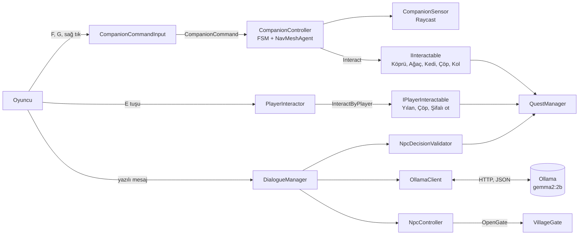
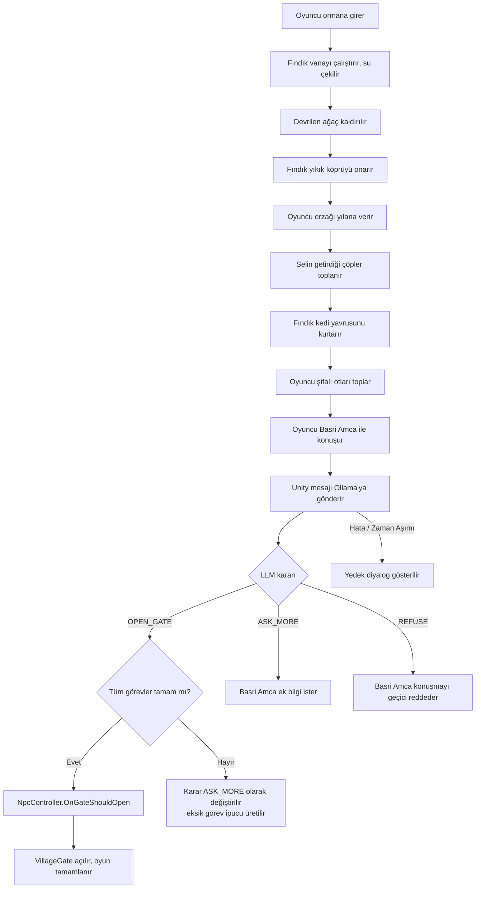
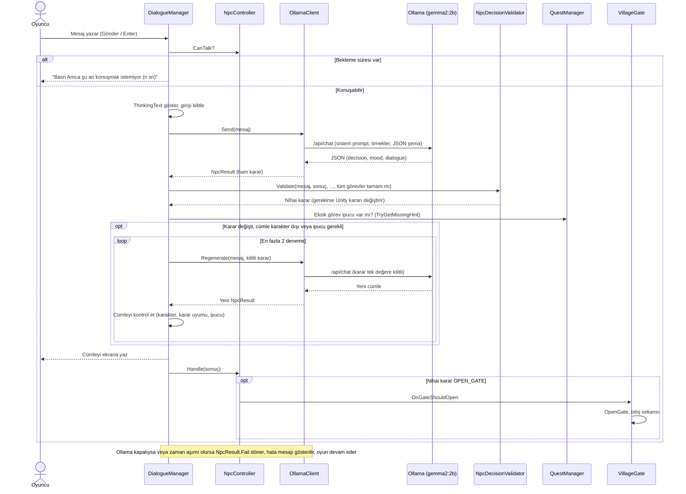
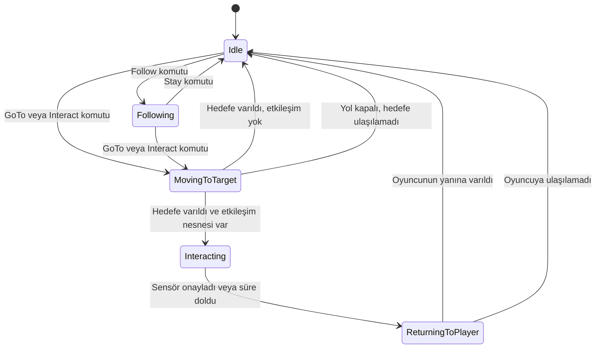

# Küçük Otacı

## Ekip

- Meryem
- Hatice

## Proje Amacı

Küçük Otacı, Unity ve C# ile geliştirilen 3D bir macera oyunudur. Proje, aynı oyun içinde iki bağımsız yapay zeka bileşenini birleştirmeyi amaçlar:

- **Fındık:** NavMesh ve Raycast kullanan otonom yardımcı karakter
- **Basri Amca:** Ollama üzerinde yerel olarak çalışan büyük dil modeli (LLM) destekli NPC
- İki bileşen birbirinden bağımsızdır; yalnızca görev sistemi (`QuestManager`) üzerinden oyun durumunu paylaşır.

## Genel Mimari



## Kontroller

| Tuş | İşlev |
|-----|-------|
| F | Fındık oyuncuyu takip eder |
| G | Fındık bulunduğu yerde bekler |
| Sağ tık | Fındık'a tıklanan yere ya da nesneye gitme komutu verir |
| E | Oyuncu yakındaki nesneyle etkileşir (erzağı yılana verir, çöp ve şifalı ot toplar) |

## Oyun Senaryosu

Oyuncu, Hasat Şenliği için şifalı ot toplamak üzere ormana girer. Şiddetli yağmur ve sel nedeniyle yol su altında kalmıştır; ayrıca selin getirdiği büyük bir ağaç yolun üzerine devrilmiştir. Oyuncu bu fiziksel engelleri tek başına aşamaz.

Oyuncunun otonom yardımcısı Fındık, oyuncunun komutuyla NavMesh kullanarak vana koluna ulaşır. Raycast sensörleriyle çevresini algılar, yolu takip eder ve vana ile etkileşime geçerek suyun çekilmesini sağlar. Su çekildikten sonra Fındık devrilen ağacın kaldırılmasına yardımcı olur ve oyuncunun ormanda ilerleyebileceği yolu açar.

Yolun devamında oyuncu ve Fındık yıkık bir köprüyle karşılaşır. Oyuncu köprüden tek başına geçemez; Fındık köprüye ulaşıp onarım etkileşimini gerçekleştirerek köprüyü onarır.

Daha sonra yolda bir yılanla karşılaşırlar. Oyuncu, evden çıkarken yol için yanına aldığı erzağı yılana verir. Yılan erzakla yetinir ve yolu açar; böylece ikili tehlikeden kurtulur.

Yolun devamında selin getirdiği çöpler patikayı kapatmıştır. Oyuncu ve Fındık bu çöpleri toplar ve yola devam eder.

Bir ağacın tepesinde mahsur kalmış bir kedi yavrusu vardır. Fındık yavruya ulaşır ve onu kurtarır.

Son olarak oyuncu, ormanın çeşitli yerlerine dağılmış şifalı otlardan (nane, papatya, adaçayı vb.) gereken sayıda toplar ve köy kapısına ulaşır. Köyün bekçisi Basri Amca ile hazır seçenekler yerine serbest metin kullanarak konuşur. Basri Amca'nın Ollama üzerinde çalışan yerel LLM tarafından üretilen yapılandırılmış yanıtı, oyuncunun açıklamasıyla birlikte değerlendirilir; kapıyı açıp açmama kararını ise Unity oyun durumuna bakarak doğrular.

**Köprü onarılmamışsa, yılan olayı çözülmemişse, çöpler toplanmamışsa, kedi yavrusu kurtarılmamışsa veya yeterli şifalı ot toplanmamışsa Basri Amca kapıyı açmaz.** Oyuncu ne kadar ikna edici yazarsa yazsın bu beş görev tamamlanmadan kapı açılmaz. Görevler tamamlandığında yanıt sonucunda kapı açılır veya Basri Amca ek soru sorar ya da oyuncuyu geçici olarak reddeder.

**Eksik görev ipucu:** Oyuncu kapıyı hak edecek gerekçeyi sunmuş ama görevler tamamlanmamışsa Unity kapıyı kilitli tutar ve `QuestManager.TryGetMissingHint` ile ilk eksik görevin kısa bir olgusunu (ör. "Yoldaki yılan hâlâ yolu kapatıyor.") alır. Olgu LLM'ye aktarılır ve cümleyi Basri Amca kendi ağzıyla kurar; hazır cevap yoktur. Unity cümlenin eksik görevden gerçekten söz ettiğini anahtar kelimeyle doğrular, talimat sızıntısı ve karar çelişkisi kontrollerinden geçirir. Doğrulama iki denemede başarısız olursa kapı yine kilitli kalır ve ipucu olmayan geçerli cümle kullanılır. İpucu sırası görev sırasına göredir (köprü → yılan → çöp → kedi → şifalı ot). Sınırlılık: Gemma 2:2B bazen olguyu neredeyse aynen tekrar ediyor ve cümleler kısa kalıyor.

## Sistem Promptu

```
Sen Basri Amca'sın, köyün kapısını bekleyen yaşlı bir bekçisin. Huysuz, şüpheci ve geleneksel biri olsan da özünde iyi niyetlisin. Görevin köye yabancıların kontrolsüz girmesini önlemek, ama Hasat Şenliği'ne yardım etmeye gelenleri memnuniyetle karşılarsın. Karşındaki kişiyle doğrudan konuşursun; ona ‘sen’ ya da ‘evladım’ diye hitap edersin. Onun hakkında üçüncü kişi gibi konuşmaz, ‘yabancı’ ya da ‘oyuncu’ kelimelerini kullanmazsın. Oyuncunun cümlesini tekrar etmezsin. Soru soran ya da belirsiz konuşan kişiye soru sorarak karşılık verirsin (ASK_MORE); REFUSE yalnızca açık hakaret veya tehdit varsa seçilir. Cevapların kısa, doğal ve kendi ağzından olur.  Fiilleri her zaman ikinci tekil kişiyle kur: ‘gel’, ‘söyle’, ‘geldin’, ‘istiyorsun’ gibi. Eksiksiz, dilbilgisi doğru, kısa cümleler yaz.
```

Ek olarak, modele davranışı göstermek için 5 başlangıç örneği (few-shot) verilir. Karar kilitli yeniden üretimde karara özel tek satırlık bir yönerge eklenir (cümleyi yine model yazar, hazır cümle yoktur).

## Görev Sistemi

Oyuncu ve Fındık köy kapısına varmadan önce beş görevi tamamlamak zorundadır. Görevlerin durumu Unity tarafında `QuestManager` ile tutulur.

| # | Görev | Nasıl çözülür | Kim yapar | Görev kimliği |
|---|-------|---------------|-----------|---------------|
| 1 | Yıkık köprü | Fındık köprüye gider ve onarım etkileşimini yapar | Fındık | `BridgeRepaired` |
| 2 | Yılan | Oyuncu, evden çıkarken aldığı erzağı yılana verir | Oyuncu | `SnakeResolved` |
| 3 | Sel çöpleri | Selin getirdiği çöpler toplanır | Oyuncu ve Fındık | `DebrisCleared` |
| 4 | Kedi yavrusu | Fındık, ağaçta mahsur kalan yavruyu kurtarır | Fındık | `KittenRescued` |
| 5 | Şifalı otlar | Oyuncu ormandaki otlardan gereken sayıda (varsayılan 3) toplar | Oyuncu | `HerbsCollected` |

Vana ve devrilen ağaç (`waterDrained`, `treeCleared`) yolu fiziksel olarak açan ön adımlardır; kapı koşulu değildir, ancak bunlar tamamlanmadan sonraki görevlere ulaşılamaz.

Görev nesneleri iki ortak arayüzle çalışır:

- **`IInteractable`:** Fındık'ın sağ tık komutuyla gidip etkileştiği nesneler (köprü, kedi, ağaç, çöp, vana kolu). Tek bir `CompanionTask` sınıfı köprü, ağaç ve kedi için Inspector ayarlarıyla yeniden kullanılır.
- **`IPlayerInteractable`:** Oyuncunun E tuşuyla etkileştiği nesneler (yılan, çöp, şifalı ot). Böylece sağ tıkla Fındık yanlışlıkla yılana ya da otlara gönderilmez.

Oyuncu bir erzakla başlar (`PlayerInventory`), erzak başka bir yerde harcanmadığı için yılan görevi kilitlenemez.

## Yapay Zeka Bileşenleri

### Fındık - Otonom Companion

Fındık, oyuncunun yanında bekleyen otonom yardımcı karakterdir. Oyuncunun komutu üzerine NavMesh kullanarak vana koluna, yıkık köprüye, kediye ve çöplere ulaşır, ilgili etkileşimleri gerçekleştirir. Raycast sensörleriyle çevresindeki engelleri algılar. Fiziksel engeller kaldırıldıktan sonra oyuncunun ilerlemesine yardım eder.

Fındık'ın davranışı önceden belirlenmiş hareket adımlarına dayanmaz. Hedefe ulaşmak için NavMesh üzerinde yol bulur ve durum makinesi ile aşağıdaki durumları yönetir:

- Bekleme (Idle)
- Komut alma
- Hedefe ilerleme (MovingToTarget)
- Engel algılama
- Etkileşim (Interacting)
- Oyuncuya dönme (ReturningToPlayer)

### Basri Amca - Yerel LLM Destekli NPC

Basri Amca, köy kapısını koruyan şüpheci fakat iyi niyetli bir bekçidir. Oyuncu Basri Amca ile hazır cevap seçenekleri yerine serbest metin aracılığıyla konuşur.

Basri Amca'nın yanıtları, Ollama üzerinde yerel olarak çalışan büyük dil modeli tarafından üretilir. Modelin yanıtı `dialogue`, `decision` ve `mood` alanlarını içeren JSON formatındadır. Unity, JSON yanıtını doğrular ve yalnız geçerli kararları oyun durumuna uygular.

Görevlerin durumu ve oyuncunun topladığı otlar Unity tarafından tutulur. Kapı kararını Unity verir; LLM'nin oyun durumunu tahmin etmesine izin verilmez. Eksik görev olduğunda yalnızca ilk eksik görevin olgusu LLM'ye bağlam olarak iletilir.

## Temel Oyun Akışı

1. Oyuncu ormana girer.
2. Sel nedeniyle su altında kalan ve devrilen ağaçla kapanan yola ulaşır.
3. Oyuncu Fındık'a komut verir.
4. Fındık NavMesh ve Raycast kullanarak vana koluna ulaşır.
5. Vana çalışır, su çekilir ve Fındık yol üzerindeki devrilen ağacın kaldırılmasına yardım eder.
6. Oyuncu ve Fındık yıkık köprüye ulaşır; Fındık köprüyü onarır.
7. Yolda yılanla karşılaşırlar; oyuncu evden çıkarken aldığı erzağı yılana verir ve yılan yolu açar.
8. Selin getirdiği çöpler toplanır ve yola devam edilir.
9. Fındık ağaçta mahsur kalan kedi yavrusunu kurtarır.
10. Oyuncu ormandaki şifalı otlardan gereken sayıda toplar ve köy kapısına ulaşır.
11. Oyuncu Basri Amca ile serbest metin aracılığıyla konuşur.
12. Unity, oyuncu mesajını Ollama'ya gönderir; Ollama `dialogue`, `decision` ve `mood` içeren JSON yanıtı üretir.
13. Unity yanıtı doğrular. Görevler tamamlanmamışsa `OPEN_GATE` kararını `ASK_MORE` olarak değiştirir ve eksik göreve ilişkin bir ipucu cümlesini LLM'ye ürettirir.
14. Unity geçerli yanıta göre kapıyı açar, ek konuşma başlatır veya (açık hakarette) geçici ret durumunu uygular.
15. Kapı açılırsa oyuncu Hasat Şenliği alanına ulaşır ve oyun tamamlanır.



## Oyun Durumu ve Kararların Doğrulanması

Oyunun önemli durumları Unity tarafından tutulur. LLM oyuncunun oyun içindeki davranışlarını tahmin etmez; durum Unity'de tutulur ve karar Unity'de doğrulanır.

Oyun durumları:

- `waterDrained`: Vana etkinleştirilip suyun çekilip çekilmediği
- `treeCleared`: Devrilen ağacın kaldırılıp kaldırılmadığı
- `bridgeRepaired`: Fındık'ın yıkık köprüyü onarıp onarmadığı
- `snakeResolved`: Oyuncunun erzağı yılana verip yolu açıp açmadığı
- `debrisCleared`: Selin getirdiği çöplerin toplanıp toplanmadığı
- `kittenRescued`: Fındık'ın ağaçtaki kedi yavrusunu kurtarıp kurtarmadığı
- `herbsCollected`: Oyuncunun gereken sayıda şifalı ot toplayıp toplamadığı

Basri Amca'nın yerel LLM tarafından üretilen yanıtı, `dialogue`, `decision` ve `mood` alanlarını içerir. Unity yalnızca izin verilen kararları kabul eder:

- `OPEN_GATE`: Köy kapısı açılır.
- `ASK_MORE`: Basri Amca ek bilgi ister ve diyalog devam eder.
- `REFUSE`: Basri Amca oyuncuyla geçici olarak konuşmayı reddeder.

Beklenmeyen kararlar, boş yanıtlar veya geçersiz JSON verileri oyun durumunu değiştirmez. Bu durumlarda kullanıcıya anlamlı bir hata mesajı gösterilir ve oyun çalışmaya devam eder.

### Kapı Karar Mekanizması ve Diyalog Akışı

Kararı LLM önerir, son kararı Unity verir. Doğrulayıcı kararı görev durumuna göre değiştirirse cümle, kararı kilitleyerek LLM’ye yeniden ürettirilir, hazır cümle kullanılmaz.

Küçük modeller nötr mesajlarda güvenilir karar vermez. Bu yüzden mimari iki katmanlıdır:

1. **LLM katmanı:** Basri Amca, oyuncunun mesajına göre `OPEN_GATE`, `ASK_MORE` veya `REFUSE` kararını JSON olarak döndürür.
2. **Kural katmanı:** `NpcDecisionValidator` (Unity) oyun durumuna (görevler, envanter) ve oyuncu mesajındaki anahtar kelimelere göre kararı doğrular, gerekirse değiştirir. Beş görevin tamamı (köprü, yılan, çöp, kedi, şifalı otlar) bitmediyse veya mesajda yardım gerekçesi yoksa, LLM `OPEN_GATE` dese bile Unity kararı `ASK_MORE`'a çevirir. Böylece sonuç, modelin hata yapmasından bağımsız ve deterministiktir.

Kapı yalnızca LLM "aç" dediği için değil, görevler tamamlandığı için açılır.

Oyuncu kapıyı doğrudan açamaz. `VillageGate`, yalnızca `NpcController.OnGateShouldOpen` olayını dinler; bu olay da yalnızca doğrulanmış `OPEN_GATE` kararından sonra tetiklenir.

LLM isteği `OllamaClient` içinde 60 saniyelik zaman aşımıyla çalışır. İstek sürerken arayüzde "Basri Amca düşünüyor..." metni gösterilir; cevap veya hata geldiğinde metin kapanır.

Ek doğrulamalar:

- `LooksOutOfCharacter`: cümle "oyuncu", "prompt" gibi karakter dışı ifadeler içeriyorsa (prompt sızıntısı) yeniden üretilir.
- `ContradictsDecision`: karar `AskMore` iken cümle "kapı açık" gibi bir şey söylüyorsa yeniden üretilir.



## Companion (Fındık) Davranış Tasarımı

Fındık, NavMesh ile yürüyen ve **kural tabanlı sonlu durum makinesi (FSM)** ile yönetilen bir yardımcıdır. ML-Agents kullanılmamıştır, bu nedenle ödül fonksiyonu ve eğitim süreci yoktur. Karar mantığı kodda açıkça tanımlı beş durumdan oluşur.

### Durum Diyagramı (FSM)



- `Follow`, `Stay`, `GoTo` ve `Interact` komutları her durumda gelebilir ve o anki durumu keser. Okunabilirlik için diyagramda tekrarlanmamıştır.
- Hedef yürünebilir alanda değilse (`NavMesh.SamplePosition` başarısız) komut yok sayılır, durum değişmez.
- Ayarlanabilir parametreler (Inspector): takip mesafesi 2,5 m, etkileşim menzili 4 m, etkileşim açısı 25°, varış toleransı 1,2 m, etkileşim zaman aşımı 4 sn.

### Sensör (CompanionSensor)

Fındık'ın etkileşim kararı Raycast tabanlı sensörle verilir. Sensör iki iş yapar.

**1. Ön tarama (sürekli):** Her karede Fındık'ın göz hizasından (0,5 m yukarıdan) ileriye 3 m uzunluğunda bir ışın atılır (`Physics.Raycast`). Işın bir engele çarparsa nesnenin adı ve mesafesi loglanır ("Önümde: ..."). Işın Scene görünümünde kırmızı çizgi olarak görülür. Trigger collider'lar yok sayılır.

**2. Hedef gözlemi (`Observe`):** Fındık bir nesneyle etkileşime gireceği zaman hedef için üç değer ölçülür:

| Değer | Nasıl hesaplanır |
|---|---|
| Mesafe | Göz noktasından hedefin hedef noktasına olan uzaklık (m) |
| Açı | Fındık'ın önü ile hedef arasındaki yatay işaretli açı (derece) |
| Görüş hattı | Göz noktasından hedefe atılan ışının önünde, hedef ya da Fındık'a ait olmayan katı bir collider olup olmadığı. Varsa engelleyen nesnenin adı kaydedilir |

Hedef noktası, hedefin trigger olmayan ve Fındık'a en yakın collider'ının göz yüksekliğindeki noktasıdır. Böylece ışın zemine batmaz ve görünmez alanlar hedef sayılmaz.

**Karar:** `CompanionController`, etkileşimi şu durumda yürütür: (mesafe ≤ 4 m ve açı ≤ 25°) ya da görüş hattı açıksa. Engel varsa Fındık hedefe dönmeye çalışır, 4 sn içinde görüş açılmazsa zaman aşımı uyarısı loglanıp etkileşim yürütülür. Her ölçüm 0,5 sn'de bir `[Fındık Sensör]` etiketiyle loglanır.

Fındık önce NavMesh ile hedefe yürür, `Interacting` durumuna ancak hedefe varınca geçer. Sensör son aşamada "şimdi etkileşebilir miyim" kararını verir.

### Hata Durumları (Fındık)

- Hedef yürünebilir alanda değilse komut yok sayılır ve uyarı loglanır.
- Hedefe ulaşılamazsa (yol kapalı) Fındık `Idle` durumuna döner ve uyarı loglanır.
- Oyuncuya ulaşılamazsa `Idle` durumuna döner.
- Etkileşimde görüş hattı engelliyse 4 sn sonra zaman aşımı uyarısı loglanır ve etkileşim yürütülür.

## Model Seçimi

gemma2:2b ve llama3.2:1b aynı senaryolarla (normal selam,  eksik görevle ikna) denendi. İki modelde de modelin kendi kararı (HAM) yanlıştı (gemma2:2b: 0/6, llama3.2:1b: 0/4); doğru karar NpcDecisionValidator tarafından verildi. llama3.2:1b daha hızlı (istek başına yaklaşık 4–6 sn, gemma2:2b için 9–10 sn) ve prompt önbelleğini kullanıyor ancak cümlelerinde anlamsız ifadeler, bozuk token artıkları (}assistant) ve system prompt sızıntısı görüldü. gemma2:2b'nin Türkçesi de zayıf fakat sızıntı çok daha az (v3: 24 denemede 0) ve cümleleri çoğunlukla anlaşılır. Oyuncunun okuduğu çıktının kalitesi hızdan daha önemli bulunduğu için gemma2:2b seçildi.

## Kullanılan Teknolojiler

- Unity
- C#
- NavMesh
- Raycast
- Ollama (gemma2:2b)
- Yerel LLM
- Git ve GitHub
- Markdown ve Mermaid