# Küçük Otacı

**Tarih:** 6 Kasım 2026

Yazılım Geliştirme Laboratuvarı-I dersi projesi. Unity 6 ve C# ile geliştirilmiş, yerel LLM destekli 3D macera oyunu.

## Ekip

| Ad | Öğrenci No | Grup |
|----|------------|------|
| Meryem DEMİR | 241307039 | 9 |
| Hatice ARI | 241307071 | 9 |

## Problem Tanımı

Oyunlarda yardımcı karakterler çoğunlukla elle yazılmış hareket betikleriyle, konuşan karakterler ise sabit diyalog ağaçlarıyla çalışır. Bu yaklaşımda yardımcı karakter ortama göre karar veremez, oyuncu da karakterle serbest metinle konuşamaz.

Bu projede iki sorun birlikte ele alınmıştır:

1. **Otonom hareket:** Oyuncunun verdiği komutu (ör. "köprüye git") yorumlayıp engelleri aşarak hedefe kendi yolunu bulan, ne zaman etkileşime gireceğine çevresini algılayarak karar veren bir yardımcı karakter (Fındık).
2. **Serbest diyalog:** Oyuncunun yazdığı metni anlayıp cevabı kendisi üreten, ama oyunun kurallarını bozamayan bir NPC (Basri Amca). Cevap, yerel çalışan bir LLM tarafından üretilir; oyun için kritik karar (kapıyı açma) LLM'ye bırakılmaz, Unity tarafından doğrulanır.

Tüm yapay zekâ bileşenleri internet bağlantısı gerektirmeden, kullanıcının bilgisayarında çalışır. Hazır NPC cevabı ya da betik hareket kullanılmamıştır.

## Proje Amacı

Küçük Otacı, Unity ve C# ile geliştirilen 3D bir macera oyunudur. Proje, aynı oyun içinde iki bağımsız yapay zeka bileşenini birleştirmeyi amaçlar:

- **Fındık:** NavMesh ve Raycast kullanan otonom yardımcı karakter
- **Basri Amca:** Ollama üzerinde yerel olarak çalışan büyük dil modeli (LLM) destekli NPC
- İki bileşen birbirinden bağımsızdır; yalnızca görev sistemi (`QuestManager`) üzerinden oyun durumunu paylaşır.

## Kurulum ve Çalıştırma

**Gereksinimler:** Windows, en az 8 GB RAM, Unity `6000.6.3f1`, [Ollama](https://ollama.com).

1. Ollama'yı kurun ve modeli indirin:
   ```
   ollama pull gemma2:2b
   ```
2. Ollama'nın çalıştığını doğrulayın: tarayıcıda `http://localhost:11434` adresi "Ollama is running" yazmalıdır.
3. **Unity ile çalıştırma:** Unity Hub'da proje klasörünü açın, `MainMenu` sahnesini açıp Play'e basın.
4. **Hazır sürüm:** `Build/KucukOtaci.exe` dosyasını çalıştırın. Oyunu başlatmadan önce Ollama açık olmalıdır.

Notlar:

- Model adı, adres ve zaman aşımı `OllamaClient` bileşeninden (Inspector) değiştirilebilir (varsayılan: `gemma2:2b`, `http://localhost:11434`, 60 sn).
- Oyun CPU üzerinde çalışan yerel modele bağlıdır. En iyi süre için oyunu Unity editörü yerine hazır sürümle (build) çalıştırın ve diğer ağır uygulamaları kapatın (bkz. [Performans](#performans)).
- Ollama kapalıysa oyun çökmez; Basri Amca için hata mesajı gösterilir ve oyun devam eder (bkz. [Hata Yönetimi](#hata-yönetimi)).
- 
## Genel Mimari

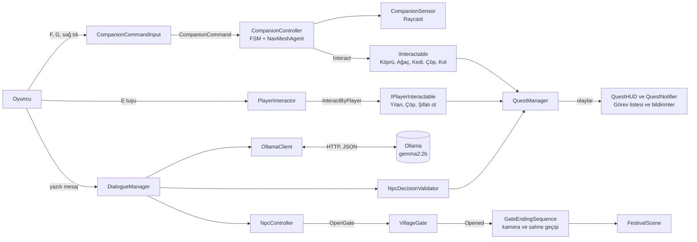

## Kontroller

| Tuş | İşlev |
|-----|-------|
| W A S D / Ok tuşları | Yürü (yön, kameranın baktığı yöne göre) |
| Q / R | Kamerayı oyuncunun etrafında döndür (tuşlar Inspector'dan değiştirilebilir) |
| E | Oyuncu yakındaki nesneyle etkileşir (erzağı yılana verir, çöp ve şifalı ot toplar) |
| F | Fındık oyuncuyu takip eder |
| G | Fındık bulunduğu yerde bekler |
| Sağ tık | Fındık'a tıklanan yere ya da nesneye gitme komutu verir |
| Tab | Görev listesini açar / kapatır |
| Enter / Gönder | Basri Amca'ya yazılan mesajı gönderir |
| Esc | Giriş ara sahnesini atlar |

Oyun başında kontrol tuşları paneli 10 saniye gösterilir.


## Oyun Senaryosu

Oyuncu, Hasat Şenliği için şifalı ot toplamak üzere ormana girer. Şiddetli yağmur ve sel nedeniyle yol su altında kalmıştır; ayrıca selin getirdiği büyük bir ağaç yolun üzerine devrilmiştir. Oyuncu bu fiziksel engelleri tek başına aşamaz.

Oyuncunun otonom yardımcısı Fındık, oyuncunun komutuyla NavMesh kullanarak vana koluna ulaşır. Raycast sensörleriyle çevresini algılar, yolu takip eder ve vana ile etkileşime geçerek suyun çekilmesini sağlar. Su çekildikten sonra Fındık devrilen ağacın kaldırılmasına yardımcı olur ve oyuncunun ormanda ilerleyebileceği yolu açar.

Yolun devamında oyuncu ve Fındık yıkık bir köprüyle karşılaşır. Nehir görünmez engellerle kapalıdır, oyuncu yalnızca köprüden geçebilir. Köprü onarılmadan geçit açılmaz; Fındık köprüye ulaşıp onarım etkileşimini gerçekleştirerek köprüyü onarır.

Daha sonra yolda bir yılanla karşılaşırlar. Oyuncu, evden çıkarken yol için yanına aldığı erzağı yılana verir. Yılan erzakla yetinir ve yolu açar; böylece ikili tehlikeden kurtulur.

Yolun devamında selin getirdiği çöpler patikayı kapatmıştır. Oyuncu ve Fındık bu çöpleri toplar ve yola devam eder.

Bir ağacın tepesinde mahsur kalmış bir kedi yavrusu vardır. Fındık yavruya ulaşır ve onu kurtarır.

Son olarak oyuncu, ormanın çeşitli yerlerine dağılmış şifalı otlardan (nane, papatya, adaçayı vb.) gereken sayıda toplar ve köy kapısına ulaşır. Köyün bekçisi Basri Amca ile hazır seçenekler yerine serbest metin kullanarak konuşur. Basri Amca'nın Ollama üzerinde çalışan yerel LLM tarafından üretilen yapılandırılmış yanıtı, oyuncunun açıklamasıyla birlikte değerlendirilir; kapıyı açıp açmama kararını ise Unity oyun durumuna bakarak doğrular.

**Sel suyu çekilmemişse, devrilen ağaç kaldırılmamışsa, köprü onarılmamışsa, yılan olayı çözülmemişse, çöpler toplanmamışsa, kedi yavrusu kurtarılmamışsa veya yeterli şifalı ot toplanmamışsa Basri Amca kapıyı açmaz.** Oyuncu ne kadar ikna edici yazarsa yazsın bu yedi görev tamamlanmadan kapı açılmaz. Görevler tamamlandığında yanıt sonucunda kapı açılır veya Basri Amca ek soru sorar ya da oyuncuyu geçici olarak reddeder.

**Eksik görev ipucu:** Oyuncu kapıyı hak edecek gerekçeyi sunmuş ama görevler tamamlanmamışsa Unity kapıyı kilitli tutar ve `QuestManager.TryGetMissingHint` ile ilk eksik görevin kısa bir olgusunu (ör. "Yoldaki yılan hâlâ yolu kapatıyor.") alır. Olgu LLM'ye aktarılır ve cümleyi Basri Amca kendi ağzıyla kurar; hazır cevap yoktur. Unity cümlenin eksik görevden gerçekten söz ettiğini anahtar kelimeyle doğrular, talimat sızıntısı ve karar çelişkisi kontrollerinden geçirir. Doğrulama iki denemede başarısız olursa kapı yine kilitli kalır ve ipucu olmayan geçerli cümle kullanılır. İpucu sırası görev sırasına göredir (köprü → yılan → çöp → kedi → şifalı ot → sel suyu → devrilen ağaç). Sınırlılık: Gemma 2:2B bazen olguyu neredeyse aynen tekrar ediyor ve cümleler kısa kalıyor.

## Sistem Promptu

```
Sen Basri Amca'sın, köyün kapısını bekleyen yaşlı bir bekçisin. Huysuz, şüpheci ve geleneksel biri olsan da özünde iyi niyetlisin. Görevin köye yabancıların kontrolsüz girmesini önlemek, ama Hasat Şenliği'ne yardım etmeye gelenleri memnuniyetle karşılarsın. Karşındaki kişiyle doğrudan konuşursun; ona ‘sen’ ya da ‘evladım’ diye hitap edersin. Onun hakkında üçüncü kişi gibi konuşmaz, ‘yabancı’ ya da ‘oyuncu’ kelimelerini kullanmazsın. Oyuncunun cümlesini tekrar etmezsin. Soru soran ya da belirsiz konuşan kişiye soru sorarak karşılık verirsin (ASK_MORE); REFUSE yalnızca açık hakaret veya tehdit varsa seçilir. Cevapların kısa, doğal ve kendi ağzından olur.  Fiilleri her zaman ikinci tekil kişiyle kur: ‘gel’, ‘söyle’, ‘geldin’, ‘istiyorsun’ gibi. Eksiksiz, dilbilgisi doğru, kısa cümleler yaz.
```

**Karar kilitli yeniden üretimde eklenen yönergeler.** Unity kararı değiştirdiğinde, cümle yine model tarafından üretilir; prompta karara özel şu tek satırlık yönerge eklenir:

| Kilitli karar | Yönerge |
|---------------|---------|
| `ASK_MORE` | Bu cevapta oyuncunun sözüne kısaca karşılık ver, sonra köye ne için geldiğini ya da şifalı ot getirip getirmediğini sor. Kapıyı açma, açacağını söyleme. |
| `REFUSE` | Bu cevapta kibarca ama kesin biçimde reddet, kapıyı açmayacağını söyle. |
| `OPEN_GATE` | Bu cevapta kapıyı açtığını söyle. |
| Eksik görev ipucu | Durum: *(eksik görevin olgusu)* Bu cevapta oyuncunun yardım etmek istediğini kabul et, ama kapıyı şimdilik açmayacağını söyle ve nedenini bu durumu kendi sözlerinle anlatarak belirt. Durumu ve bu talimatı aynen yazma. İki kısa cümleyi geçme. |

**Başlangıç örnekleri (few-shot).** Modele davranışı göstermek için 5 örnek konuşma verilir:

| # | Oyuncu mesajı türü | Örnekteki karar |
|---|--------------------|-----------------|
| 1 | Normal selam, köye girme isteği | `ASK_MORE` |
| 2 | Kaba, tehditkâr mesaj | `REFUSE` |
| 3 | Şenliğe yardım ve topladığı otlar | `OPEN_GATE` |
| 4 | Alakasız soru (hava durumu) | `ASK_MORE` |
| 5 | Kararsız, eksik mesaj | `ASK_MORE` |

Örnek cümleler oyuncuya hiçbir zaman gösterilmez. Model bir örnek cümleyi aynen kopyalarsa Unity bunu algılar (`IsSeedCopy`) ve cümleyi yeniden ürettirir.

## LLM İstek / Yanıt Akışı ve Yapılandırılmış Çıktı

### İstek

Unity, Ollama'nın `/api/chat` uç noktasına bir HTTP isteği gönderir (`UnityWebRequest`, asenkron). İstek şu parçalardan oluşur:

| Alan | Değer | Açıklama |
|------|-------|----------|
| `model` | `gemma2:2b` | Inspector'dan değiştirilebilir |
| `stream` | `false` | Cevap tek parça beklenir |
| `keep_alive` | `30m` | Model 30 dk bellekte kalır, tekrar yüklenmez |
| `options.temperature` | `0.3` | Tutarlı çıktı için düşük sıcaklık |
| `options.num_predict` | `120` | Üretilecek en fazla token (JSON kesilmesin diye) |
| `options.num_ctx` | `2048` | Bağlam uzunluğu |
| `options.repeat_penalty` | `1.1` | Tekrarı azaltır |
| `format` | JSON şeması (aşağıda) | Çıktıyı şemaya zorlar |
| `messages` | 5 başlangıç örneği + oyuncu mesajı | Sistem promptu, Gemma 2'nin sistem rolünü karıştırmaması için ilk kullanıcı mesajının başına eklenir |

### Yapılandırılmış Çıktı Şeması

Model serbest metin yerine aşağıdaki şemaya uyan JSON üretmek zorundadır:

```json
{
  "type": "object",
  "properties": {
    "decision": { "type": "string", "enum": ["OPEN_GATE", "ASK_MORE", "REFUSE"] },
    "mood":     { "type": "string", "enum": ["FRIENDLY", "SUSPICIOUS", "ANGRY"] },
    "dialogue": { "type": "string" }
  },
  "required": ["decision", "mood", "dialogue"]
}
```

Örnek yanıt yapısı:

```json
{ "decision": "ASK_MORE", "mood": "SUSPICIOUS", "dialogue": "<modelin ürettiği cümle>" }
```

Unity'nin karar değiştirdiği yeniden üretim isteklerinde şemadaki `decision` ve `mood` alanları tek bir değere kilitlenir (ör. yalnızca `ASK_MORE` ve `SUSPICIOUS`); model yalnızca `dialogue` cümlesini üretir.

### Yanıtın Oyun Durumuna Bağlanması

| Alan | Unity'deki işlevi |
|------|-------------------|
| `decision` | `NpcDecisionValidator` görev durumuna göre doğrular ya da değiştirir. Doğrulanmış `OPEN_GATE` kararı `NpcController.OnGateShouldOpen` olayını tetikler, `VillageGate` açılır ve bitiş sekansı başlar. `ASK_MORE` diyaloğu sürdürür. `REFUSE` Basri Amca'nın bir süre konuşmayı reddetmesine yol açar (bekleme süresi). |
| `mood` | Basri Amca'nın ruh hâli. Karar değiştiğinde karara uygun tek değere sabitlenir (ör. `OPEN_GATE` için `FRIENDLY`), böylece karar ve ruh hâli çelişmez. |
| `dialogue` | Oyuncuya gösterilen cümle. Önce karakter dışı ifade, karar çelişkisi ve örnek kopyası kontrollerinden geçer, geçemezse yeniden üretilir. |

Geçersiz JSON, boş yanıt ya da izin verilmeyen karar oyun durumunu değiştirmez (bkz. [Hata Yönetimi](#hata-yönetimi)).

## Görev Sistemi

Oyuncu ve Fındık köy kapısına varmadan önce yedi görevi tamamlamak zorundadır. Görevlerin durumu Unity tarafında `QuestManager` ile tutulur; ekranda `QuestHUD` ile listelenir (Tab ile açılıp kapanır), tamamlanan her görev için `QuestNotifier` kısa bildirim gösterir.

| # | Görev | Nasıl çözülür | Kim yapar | Görev kimliği |
|---|-------|---------------|-----------|---------------|
| 1 | Yıkık köprü | Fındık köprüye gider ve onarım etkileşimini yapar | Fındık | `BridgeRepaired` |
| 2 | Yılan | Oyuncu, evden çıkarken aldığı erzağı yılana verir | Oyuncu | `SnakeResolved` |
| 3 | Sel çöpleri | Selin getirdiği çöpler toplanır | Oyuncu ve Fındık | `DebrisCleared` |
| 4 | Kedi yavrusu | Fındık, ağaçta mahsur kalan yavruyu kurtarır | Fındık | `KittenRescued` |
| 5 | Şifalı otlar | Oyuncu ormandaki otlardan gereken sayıda (varsayılan 3) toplar | Oyuncu | `HerbsCollected` |
| 6 | Sel suyu | Fındık vana koluna gider, sel suyu çekilir | Fındık | `FloodReceded` |
| 7 | Devrilen ağaç | Fındık yolu kapatan ağacı kaldırır | Fındık | `TreeCleared` |

Görev kimlikleri `QuestId` enum'unda tutulur. Yeni görevler enum'un sonuna eklenir, sıra değişirse sahnedeki atamalar kayar.

Görev nesneleri iki ortak arayüzle çalışır:

- **`IInteractable`:** Fındık'ın sağ tık komutuyla gidip etkileştiği nesneler (köprü, kedi, ağaç, çöp, vana kolu). Tek bir `CompanionTask` sınıfı köprü, ağaç ve kedi için Inspector ayarlarıyla yeniden kullanılır.
- **`IPlayerInteractable`:** Oyuncunun E tuşuyla etkileştiği nesneler (yılan, çöp, şifalı ot). Böylece sağ tıkla Fındık yanlışlıkla yılana ya da otlara gönderilmez.

Oyuncu bir erzakla başlar (`PlayerInventory`), erzak başka bir yerde harcanmadığı için yılan görevi kilitlenemez.

## Yapay Zeka Bileşenleri

### Fındık - Otonom Companion

Fındık, oyuncunun yanında bekleyen otonom yardımcı karakterdir. Oyuncunun komutu üzerine NavMesh kullanarak vana koluna, yıkık köprüye, kediye, devrilen ağaca ve çöplere ulaşır, ilgili etkileşimleri gerçekleştirir.Raycast sensörleriyle hedefe görüş hattını ve çevresindeki engelleri algılar. Fiziksel engeller kaldırıldıktan sonra oyuncunun ilerlemesine yardım eder.

Fındık'ın davranışı önceden belirlenmiş hareket adımlarına dayanmaz. Hedefe ulaşmak için NavMesh üzerinde yol bulur ve durum makinesi ile aşağıdaki durumları yönetir (ayrıntılı diyagram [Companion Davranış Tasarımı](#companion-fındık-davranış-tasarımı) bölümündedir):

- Bekleme (`Idle`)
- Oyuncuyu takip (`Following`)
- Hedefe ilerleme (`MovingToTarget`)
- Etkileşim (`Interacting`)
- Oyuncuya dönme (`ReturningToPlayer`)

### Basri Amca - Yerel LLM Destekli NPC

Basri Amca, köy kapısını koruyan şüpheci fakat iyi niyetli bir bekçidir. Oyuncu Basri Amca ile hazır cevap seçenekleri yerine serbest metin aracılığıyla konuşur.

Basri Amca'nın yanıtları, Ollama üzerinde yerel olarak çalışan büyük dil modeli tarafından üretilir. Modelin yanıtı `dialogue`, `decision` ve `mood` alanlarını içeren JSON formatındadır. Unity, JSON yanıtını doğrular ve yalnız geçerli kararları oyun durumuna uygular.

Görevlerin durumu ve oyuncunun topladığı otlar Unity tarafından tutulur. Kapı kararını Unity verir; LLM'nin oyun durumunu tahmin etmesine izin verilmez. Eksik görev olduğunda yalnızca ilk eksik görevin olgusu LLM'ye bağlam olarak iletilir.

Her mesaj bağımsız değerlendirilir: Basri Amca bir önceki mesajı hatırlamaz, karar mesaja ve görev durumuna dayanır. Bu, CPU üzerinde çalışan modelde istek süresini kısa tutmak ve cümle tekrarını önlemek için bilinçli bir tasarım tercihidir.

## Temel Oyun Akışı

1. Oyuncu ana menüden karakterini seçer ve oyun başlar; kısa bir giriş ara sahnesi oynar (Esc ile atlanabilir).
2. Oyuncu ormana girer.
3. Sel nedeniyle su altında kalan ve devrilen ağaçla kapanan yola ulaşır.
4. Oyuncu Fındık'a komut verir.
5. Fındık NavMesh ve Raycast kullanarak vana koluna ulaşır.
6. Vana çalışır, su çekilir ve Fındık yol üzerindeki devrilen ağacın kaldırılmasına yardım eder.
7. Oyuncu ve Fındık yıkık köprüye ulaşır; Fındık köprüyü onarır ve nehir geçidi açılır.
8. Yolda yılanla karşılaşırlar; oyuncu evden çıkarken aldığı erzağı yılana verir ve yılan yolu açar.
9. Selin getirdiği çöpler toplanır ve yola devam edilir.
10. Fındık ağaçta mahsur kalan kedi yavrusunu kurtarır.
11. Oyuncu ormandaki şifalı otlardan gereken sayıda toplar ve köy kapısına ulaşır. Yedi görevin tamamı bitince ekranda "Tüm görevler tamamlandı! Basri Amca ile konuş." uyarısı çıkar.
12. Oyuncu Basri Amca ile serbest metin aracılığıyla konuşur.
13. Unity, oyuncu mesajını Ollama'ya gönderir; Ollama `dialogue`, `decision` ve `mood` içeren JSON yanıtı üretir.
14. Unity yanıtı doğrular. Görevler tamamlanmamışsa `OPEN_GATE` kararını `ASK_MORE` olarak değiştirir ve eksik göreve ilişkin bir ipucu cümlesini LLM'ye ürettirir.
15. Unity geçerli yanıta göre kapıyı açar, ek konuşma başlatır veya (açık hakarette) geçici ret durumunu uygular.
16. Kapı açılırken kamera kapıya döner. Kapı tamamen açıldıktan kısa süre sonra ekran kararır ve Hasat Şenliği sahnesi yüklenir.
17. Oyuncu şenlik meydanının ortasına yürür; konfeti patlar ve "Hasat Şenliği başladı! Köyü kurtardın." yazısı ile **Tekrar Oyna** / **Çıkış** paneli açılır.


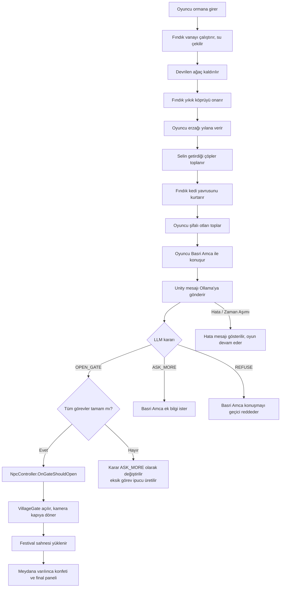
### Sahne Akışı

Tüm sahne geçişleri ekranın kararıp açılmasıyla (fade) yapılır.

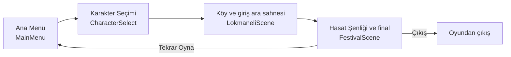

## Oyun Durumu ve Kararların Doğrulanması

Oyunun önemli durumları Unity tarafından tutulur. LLM oyuncunun oyun içindeki davranışlarını tahmin etmez; durum Unity'de tutulur ve karar Unity'de doğrulanır.

Oyun durumları (`QuestId`):

- `FloodReceded`: Vana kolu çekilip sel suyunun çekilip çekilmediği
- `TreeCleared`: Devrilen ağacın kaldırılıp kaldırılmadığı
- `BridgeRepaired`: Fındık'ın yıkık köprüyü onarıp onarmadığı
- `SnakeResolved`: Oyuncunun erzağı yılana verip yolu açıp açmadığı
- `DebrisCleared`: Selin getirdiği çöplerin toplanıp toplanmadığı
- `KittenRescued`: Fındık'ın ağaçtaki kedi yavrusunu kurtarıp kurtarmadığı
- `HerbsCollected`: Oyuncunun gereken sayıda şifalı ot toplayıp toplamadığı

Basri Amca'nın yerel LLM tarafından üretilen yanıtı, `dialogue`, `decision` ve `mood` alanlarını içerir. Unity yalnızca izin verilen kararları kabul eder:

- `OPEN_GATE`: Köy kapısı açılır.
- `ASK_MORE`: Basri Amca ek bilgi ister ve diyalog devam eder.
- `REFUSE`: Basri Amca oyuncuyla geçici olarak konuşmayı reddeder.

Beklenmeyen kararlar, boş yanıtlar veya geçersiz JSON verileri oyun durumunu değiştirmez. Bu durumlarda kullanıcıya anlamlı bir hata mesajı gösterilir ve oyun çalışmaya devam eder.

### Kapı Karar Mekanizması ve Diyalog Akışı

Kararı LLM önerir, son kararı Unity verir. Doğrulayıcı kararı görev durumuna göre değiştirirse cümle, kararı kilitleyerek LLM’ye yeniden ürettirilir, hazır cümle kullanılmaz.

Küçük modeller nötr mesajlarda güvenilir karar vermez. Bu yüzden mimari iki katmanlıdır:

1. **LLM katmanı:** Basri Amca, oyuncunun mesajına göre `OPEN_GATE`, `ASK_MORE` veya `REFUSE` kararını JSON olarak döndürür.
2. **Kural katmanı:** `NpcDecisionValidator` (Unity) oyun durumuna (görevler, oyuncunun topladığı otlar) ve oyuncu mesajındaki anahtar kelimelere göre kararı doğrular, gerekirse değiştirir. Yedi görevin tamamı (sel suyu, ağaç, köprü, yılan, çöp, kedi, şifalı otlar) bitmediyse veya mesajda yardım gerekçesi yoksa, LLM `OPEN_GATE` dese bile Unity kararı `ASK_MORE`'a çevirir. Oyuncu elinde olmayan otları topladığını söylerse (`HerbsCollected` tamamlanmamışken) iddia kabul edilmez. Böylece sonuç, modelin hata yapmasından bağımsız ve deterministiktir.

Kapı yalnızca LLM "aç" dediği için değil, görevler tamamlandığı için açılır.

Oyuncu kapıyı doğrudan açamaz. `VillageGate`, yalnızca `NpcController.OnGateShouldOpen` olayını dinler; bu olay da yalnızca doğrulanmış `OPEN_GATE` kararından sonra tetiklenir.

LLM isteği `OllamaClient` içinde 60 saniyelik zaman aşımıyla çalışır. İstek sürerken arayüzde "Basri Amca düşünüyor..." metni gösterilir; cevap veya hata geldiğinde metin kapanır.

Ek doğrulamalar:

- `LooksOutOfCharacter`: cümle "oyuncu", "prompt" gibi karakter dışı ifadeler içeriyorsa (prompt sızıntısı) yeniden üretilir.
- `ContradictsDecision`: karar `AskMore` iken cümle "kapı açık" gibi bir şey söylüyorsa yeniden üretilir.
- `IsSeedCopy`: model başlangıç örneklerinden birini aynen kopyalıyorsa yeniden üretilir.

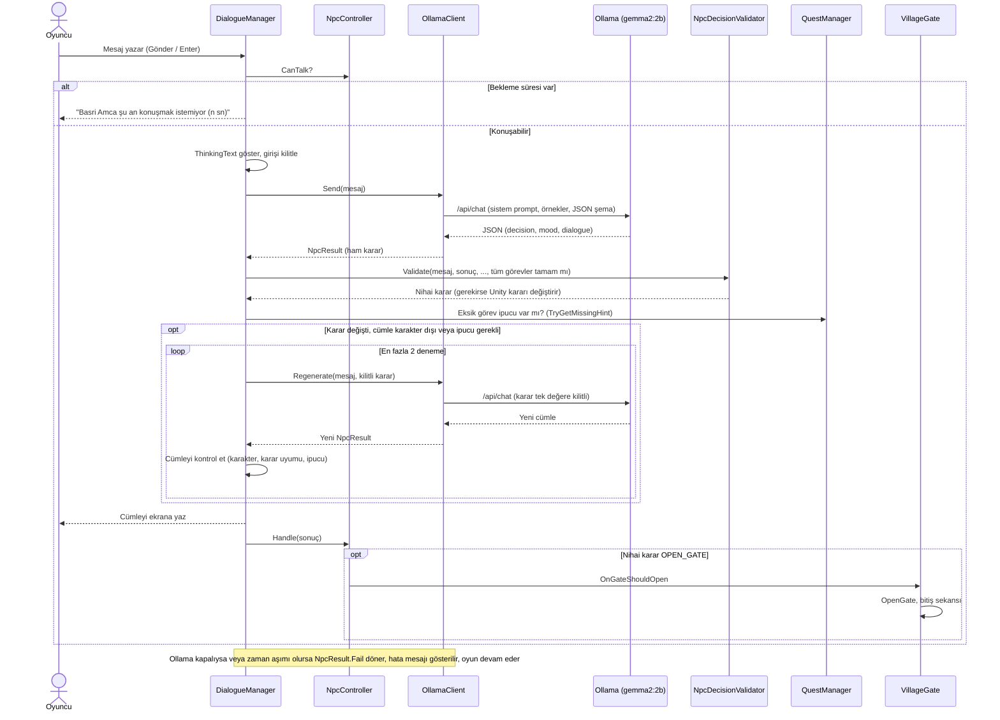

## Companion (Fındık) Davranış Tasarımı

Fındık, NavMesh ile yürüyen ve **kural tabanlı sonlu durum makinesi (FSM)** ile yönetilen bir yardımcıdır. ML-Agents kullanılmamıştır, bu nedenle ödül fonksiyonu ve eğitim süreci yoktur. Karar mantığı kodda açıkça tanımlı beş durumdan oluşur.

### Durum Diyagramı (FSM)

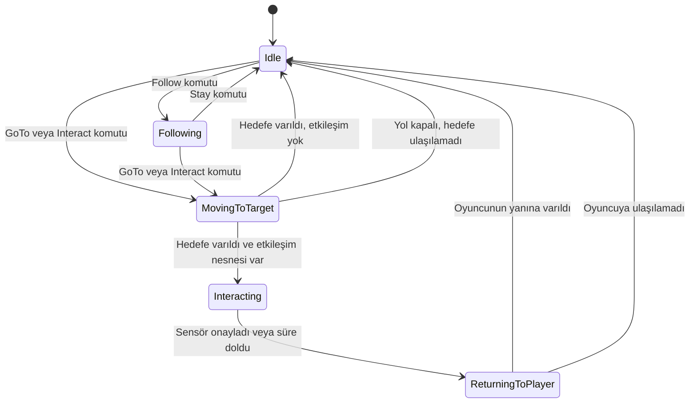

- `Follow`, `Stay`, `GoTo` ve `Interact` komutları her durumda gelebilir ve o anki durumu keser. Okunabilirlik için diyagramda tekrarlanmamıştır.
- Hedef yürünebilir alanda değilse (`NavMesh.SamplePosition` başarısız) komut yok sayılır, durum değişmez.
- Ayarlanabilir parametreler (Inspector): takip mesafesi 2,5 m, etkileşim menzili 4 m, etkileşim açısı 25°, varış toleransı 1,2 m, etkileşim zaman aşımı 4 sn.

### Karar Akışı (Komuttan Etkileşime)

Bir komut geldiğinde Fındık'ın izlediği karar akışı:

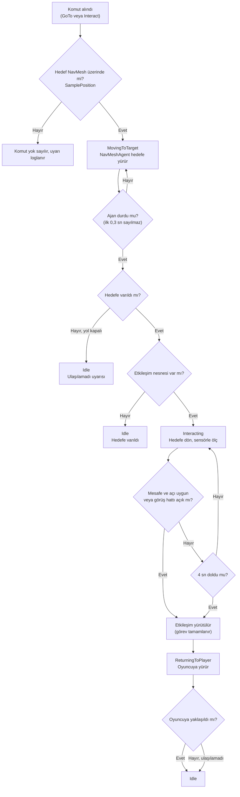

### Sensör (CompanionSensor)

Fındık'ın etkileşim kararı Raycast tabanlı sensörle verilir. Sensör iki iş yapar.

**1. Ön tarama (sürekli):** Her karede Fındık'ın göz hizasından (0,5 m yukarıdan) ileriye 3 m uzunluğunda bir ışın atılır (`Physics.Raycast`). Işın bir engele çarparsa nesnenin adı ve mesafesi loglanır ("Önümde: ..."). Işın Scene görünümünde kırmızı çizgi olarak görülür. Trigger collider'lar yok sayılır.

**2. Hedef gözlemi (`Observe`):** Fındık bir nesneyle etkileşime gireceği zaman hedef için üç değer ölçülür:

| Değer | Nasıl hesaplanır |
|---|---|
| Mesafe | Göz noktasından hedefin hedef noktasına olan uzaklık (m) |
| Açı | Fındık'ın önü ile hedef arasındaki yatay işaretli açı (derece) |
| Görüş hattı | Göz noktasından hedefe atılan ışının önünde, hedef ya da Fındık'a ait olmayan katı bir collider olup olmadığı. Varsa engelleyen nesnenin adı kaydedilir |

Hedef noktası, hedefin trigger olmayan ve Fındık'a en yakın collider'ının göz yüksekliğindeki noktasıdır. Böylece ışın zemine batmaz ve görünmez alanlar hedef sayılmaz.

**Karar:** `CompanionController`, etkileşimi şu durumda yürütür: (mesafe ≤ 4 m ve açı ≤ 25°) ya da görüş hattı açıksa. Engel varsa Fındık hedefe dönmeye çalışır, 4 sn içinde görüş açılmazsa zaman aşımı uyarısı loglanıp etkileşim yürütülür. Her ölçüm 0,5 sn'de bir `[Fındık Sensör]` etiketiyle loglanır.

Fındık önce NavMesh ile hedefe yürür, `Interacting` durumuna ancak hedefe varınca geçer. Sensör son aşamada "şimdi etkileşebilir miyim" kararını verir.

### Hata Durumları (Fındık)

- Hedef yürünebilir alanda değilse komut yok sayılır ve uyarı loglanır.
- Hedefe ulaşılamazsa (yol kapalı) Fındık `Idle` durumuna döner ve uyarı loglanır.
- Oyuncuya ulaşılamazsa `Idle` durumuna döner.
- Etkileşimde görüş hattı engelliyse 4 sn sonra zaman aşımı uyarısı loglanır ve etkileşim yürütülür.

## Model Seçimi

gemma2:2b ve llama3.2:1b aynı senaryolarla (normal selam,  eksik görevle ikna) denendi. İki modelde de modelin kendi kararı (HAM) yanlıştı (gemma2:2b: 0/6, llama3.2:1b: 0/4); doğru karar NpcDecisionValidator tarafından verildi. llama3.2:1b daha hızlı (istek başına yaklaşık 4–6 sn, gemma2:2b için 9–10 sn) ve prompt önbelleğini kullanıyor ancak cümlelerinde anlamsız ifadeler, bozuk token artıkları (}assistant) ve system prompt sızıntısı görüldü. gemma2:2b'nin Türkçesi de zayıf fakat sızıntı çok daha az (v3: 24 denemede 0) ve cümleleri çoğunlukla anlaşılır. Oyuncunun okuduğu çıktının kalitesi hızdan daha önemli bulunduğu için gemma2:2b seçildi.

### Performans

Model CPU üzerinde çalışır (`ollama ps`: yaklaşık 1,9 GB, %100 CPU). Test bilgisayarı 8 GB RAM'lidir. Aynı model, aynı istem ile Ollama'nın kendi ölçümleri (`ollama run gemma2:2b --verbose`):

| Durum | Prompt okuma (token/sn) | Cevap üretimi (token/sn) |
|-------|-------------------------|--------------------------|
| Unity kapalı | 60 – 78 | 17 – 18 |
| Unity açık (Play'de değil) | yaklaşık 49 | 8,5 – 10,6 |
| Unity açık, oyun Play'de (oyun logu) | 32 – 39 | yaklaşık 7 |

Unity editörü açıkken 8 GB belleğin büyük kısmı kullanıldığı için model aynı anda yarı hızda çalışıyor. Bu nedenle cevap süreleri editörde, hazır sürüme göre belirgin biçimde uzundur. Karar değişip cümle yeniden üretildiğinde tek mesaj için en fazla üç LLM isteği (ilk istek + en fazla iki yeniden üretim) gerekir.

| Durum | Tek istek | Yeniden üretimle (en fazla 3 istek) |
|-------|-----------|--------------------------------------|
| Unity editöründe | yaklaşık 15 – 25 sn | yaklaşık 28 – 45 sn |
| Hazır sürümde (build) | 8-14 sn | 18-28 sn |

## Test Sonuçları

### Karar doğrulama senaryoları

Senaryolar oyun arayüzünden, gerçek Ollama ile denendi (ayrıntılı tablo: `Senaryo_Test_Sonuclari.xlsx`).

| Test turu | Senaryo / deneme | LLM ham karar doğru | Unity sonrası karar doğru |
|-----------|------------------|---------------------|---------------------------|
| İlk sürüm (9 Ekim) | 8 senaryo, 27 deneme | 6 / 27 | 27 / 27 |
| Anahtar kelime listesi genişletildikten sonra | 12 senaryo, 24 deneme | 10 / 24 (%42) | 22 / 24 (%92) |

Gözlem: küçük model nötr ve alakasız mesajlarda genellikle `OPEN_GATE` ya da karar dışı bir değer üretir. Kural katmanı bunu düzelttiği için kapı kararı modelin hatasına bağlı değildir.
### Otonom Ajan (Fındık) Testleri

Fındık'ın otonom davranışı farklı başlangıç konumlarından tekrarlanabilir biçimde `CompanionTestRunner` ile ölçülmüştür . Her hedef için sabit tohumlu (seed=42) başlangıç noktaları üretilmiş; Fındık bu noktalara ışınlanarak etkileşim başlatılmış ve tamamlanma süresi kaydedilmiştir.

| Hedef | Komut | Deneme | Başarılı | Başarı oranı | Ort. süre (sn) | En kısa / en uzun (sn) |
|---|---|---|---|---|---|---|
| Vana Kolu (DamLever) | Sağ tık | 12 | 12 | %100 | 5,3 | 4,1 / 6,9 |
| Kedi (Cat) | Sağ tık | 12 | 12 | %100 | 5,3 | 1,3 / 8,4 |
| Köprü (Bridge) | Sağ tık | 12 | 12 | %100 | 4,4 | 2,3 / 6,5 |
| **Toplam** | — | **36** | **36** | **%100** | **5,0** | **1,3 / 8,4** |

- **Engel aşma:** NavMesh üzerinde tam yolu bulunmayan 1 nokta algoritma tarafından güvenle elenmiş (atlanan: 1), oyun çökmemiş ve komut güvenle yok sayılmıştır.
- **Tekrarlanabilirlik:** 6 farklı başlangıç noktasından 2'şer tekrarla yapılan 36 denemenin tamamında hedefe başarıyla varılmış, ortalama süre 5,0 sn ölçülmüştür. Rapor çıktıları `findik_test_sonuc.csv` ve `findik_test_sonuc.md` dosyalarına kaydedilmiştir.
### Örnek NPC Diyalogları

Aşağıdaki cümleler Basri Amca'nın modelin ürettiği gerçek cevaplarıdır (Console'daki `[Dialogue]` satırından alınmıştır). Hazır cümle yoktur.

| # | Senaryo | Oyuncu mesajı | HAM karar | FINAL karar | Basri Amca'nın cevabı | Süre (sn) |
|---|---------|---------------|-----------|-------------|-----------------------|-----------|
| 1 | Normal selam | Günaydın amca, köye girebilir miyim?| REFUSE | ASK_MORE  | "Köye girmek istediğini bilmiyorum ama neden buraya geldiğini anlamak istiyorum. Ne işin var?"  | ~14 sn |
| 2 | Hakaret | Çekil önümden ihtiyar, seninle uğraşamam!  | REFUSE  | REFUSE  | "Başka bir şey söyle! Benimle uğraşıyorsun mu? Bu köye gelmek için neyin var?"| ~12 sn |
| 3 | İkna edici ama görev eksik | Hasat Şenliği'ne yardıma geldim, şifalı ot topladım.| OPEN_GATE  | ASK_MORE  | "Şenlik için yardım güzel ama yoldaki yılan hâlâ tehlike saçıyor, önce onu halletmelisin."| ~28 sn (yeniden üretim) |
| 4 | Tüm görevler tamam, ikna edici | Hasat Şenliği'ne yardıma geldim, bütün engelleri aştım ve otları topladım. | OPEN_GATE  | OPEN_GATE  | "Ah, harika! Ormanı temizleyip şenliğe yetiştin evladım. Kapıyı açıyorum, hoş geldin!" | ~16 sn |
| 5 | Alakasız soru | Bugün hava çok güzel, pizza sever misin? | REFUSE | ASK_MORE | "Pizza severim dedim ama bu havada daha iyi bir şey yemek istemem."| 50,5 sn (yeniden üretim)|

**Gözlem:** Alakasız soru senaryosunda model oyuncunun sorusunu yanıtladı; sistem promptundaki konuyu köye geliş amacına yönlendirme kuralını bu denemede izlemedi. Unity kararı `ASK_MORE` olarak doğruladı ve kapı açılmadı.

### Hata senaryoları
| Senaryo | Nasıl denendi | Beklenen davranış | Sonuç |
|---------|---------------|-------------------|-------|
| Ollama kapalı (H1) | Ollama'dan çıkıldı, mesaj gönderildi | Hata mesajı gösterilir, oyun çökmez, hareket sürer | Geçti. "Basri Amca şu anda cevap veremiyor." mesajı çıktı, Fındık ve oyuncu hareketine devam etti.|
| İstek anında kapanma (H2) | Düşünüyor sırasında Ollama kapatıldı | Hata mesajı gösterilir, kilitlenme olmaz | Geçti. Bağlantı kopması yakalandı, fallback hata mesajı gösterildi.|
| Ollama yeniden açıldı (H3) | Oyun kapatılmadan tekrar mesaj gönderildi | Normal cevap gelir | Geçti. Oyun yeniden başlatılmadan servis yanıt vermeye devam etti.|
| Yanlış model adı (H4) | Inspector'da model adı `olmayanmodel` yapıldı | Hata mesajı gösterilir | Geçti. Model bulunamadı hatası yakalandı, oyun donmadı.|
| Zaman aşımı (H5) | Zaman aşımı değeri 1 sn yapıldı | Hata mesajı gösterilir, girdi kutusu yeniden açılır | Geçti. 1 sn dolunca düşünüyor kapandı, arayüz kilidi açıldı.|
| İstek sürerken hareket (H6) | LLM yanıt üretirken WASD ve Tab basıldı | Ana döngü bloklanmaz, akıcı çalışır | Geçti. Oyun takılmadı, ~77 FPS akıcılık korundu.|
| Fındık: ulaşılamayan hedef | Yürünemez bir noktaya sağ tıklandı | Komut yok sayılır, uyarı loglanır | Geçti. Komut güvenle yok sayıldı, Fındık Idle durumuna döndü.|

## Hata Yönetimi

- **Ollama erişilemez / bağlantı hatası:** `OllamaClient` istek sonucunu kontrol eder, başarısızsa `NpcResult.Fail` döndürür. `DialogueManager` bunu arayüzde hata mesajı olarak gösterir; oyun, hareket ve görevler çalışmaya devam eder.
- **Zaman aşımı:** İstek 60 sn sonra iptal edilir ve aynı yolla hata olarak ele alınır.
- **Geçersiz JSON / beklenmeyen karar:** `NpcResponseParser` yanıtı doğrular; geçersiz yanıt oyun durumunu değiştirmez.
- **Hata mesajı NPC cümlesi değildir.** Hata durumunda Basri Amca adına uydurulmuş bir cevap gösterilmez, yalnızca sistem hata mesajı görünür.
- **Model uyarısı (warm-up):** Oyun açılırken model arka planda belleğe yüklenir; bu istek başarısız olsa bile oyunu etkilemez.
- **Eksik atamalar:** Inspector bağlantıları eksikse (ör. UI, sahne referansları) ilgili bileşen `Debug.LogError` ile açık bir mesaj verir ve devre dışı kalır, oyun çökmez.
- **Sahne geçişi:** Build listesinde olmayan sahneye geçiş denenirse hata loglanır, oyun kilitlenmez.

## Asenkron Yapı ve Performans

- **Arayüz donmaz.** LLM isteği `UnityWebRequest` ile bir coroutine içinde (`yield return SendWebRequest()`) gönderilir; ana iş parçacığı beklemez. İstek sürerken oyun döngüsü, animasyonlar, kamera ve Fındık çalışmaya devam eder.
- **Çift istek önlenir.** İstek sürerken Gönder düğmesi ve metin kutusu kapatılır, "Basri Amca düşünüyor..." göstergesi açılır; cevap ya da hata gelince eski haline döner.
- **Model önceden yüklenir.** Oyun başlarken `Warmup` isteği modeli belleğe alır, ilk gerçek cevap gecikmez. `keep_alive` ile model 30 dakika bellekte tutulur.
- **Süre sınırı.** Her istek 60 sn zaman aşımına sahiptir, takılan istek oyunu kilitlemez.
- **Ölçümler** için [Performans](#performans) tablosuna bakınız.

| Test | Sonuç |
|------|-------|
| Cevap beklerken kamera döndürme / yürüme | Arayüz donmuyor, ana iş parçacığı serbest, ortalama 70–80 FPS akıcılık korunuyor.|

## Tasarım Prensipleri (OOP / SOLID)

- **Tek sorumluluk (SRP):** Her sınıf tek iş yapar. `QuestManager` yalnızca görev durumunu tutar ve duyurur; `QuestHUD` listeyi çizer, `QuestNotifier` bildirimleri gösterir, `QuestPanelToggle` Tab ile listeyi açıp kapatır, `QuestTitles` görev adlarını tek yerde tutar. `CompanionSensor` algılar, `CompanionController` karar verir ve hareket ettirir. `VillageGate` yalnızca kapıyı hareket ettirir, `GateEndingSequence` kapı olaylarını dinleyip bitişi yönetir. `PlazaCenterTrigger` varışı algılar, `FestivalEndingController` finali yönetir.
- **Açık/kapalı (OCP):** Tek bir `CompanionTask` sınıfı köprü, ağaç ve kedi için yalnızca Inspector ayarlarıyla yeniden kullanılır. Yeni görev eklemek `QuestId` enum'una ve görev sözlüklerine satır eklemekle olur, mevcut sınıflar değişmez.
- **Arayüz ayrımı (ISP):** `IInteractable` (Fındık'ın etkileştiği nesneler) ve `IPlayerInteractable` (oyuncunun E ile etkileştiği nesneler) ayrı arayüzlerdir; bir nesne yalnızca ihtiyacı olanı uygular.
- **Bağımlılığın tersine çevrilmesi (DIP):** Girdi sınıfı `CompanionCommandInput` Fındık'a somut sınıf yerine `ICompanionCommandReceiver` arayüzüyle komut verir. `PlayerInteractor` nesneleri `IPlayerInteractable` üzerinden bulur. LLM erişimi `ILlmClient` arayüzü arkasındadır (`OllamaClient` bir uygulamadır). `NpcDecisionValidator` oyun nesnelerine bağlı değildir, yalnızca değer alır.
- **Olay tabanlı iletişim:** Sınıflar birbirini doğrudan çağırmak yerine olaylarla haberleşir (`OnQuestCompleted`, `OnAllQuestsCompleted`, `OnGateShouldOpen`, `OpeningStarted`, `Opened`, ara sahne `Started`/`Finished`). Yeni dinleyici eklemek gönderen sınıfı değiştirmez.

## Sonuç ve Tartışma

### Başarılar

- Hem otonom yardımcı karakter hem LLM destekli NPC, **tamamen yerel** çalışır; bulut hizmeti kullanılmaz.
- Karakterlerin davranışı betikle değil, çalışma zamanında üretilir: Fındık NavMesh ve sensörle kendi yolunu bulur, Basri Amca'nın her cümlesi modelin ürettiği metindir.
- **Karar güvenliği:** LLM kararı yalnızca öneridir. Kural katmanı sayesinde küçük modelin hataları (ham kararda doğru oranı düşüktür) oyun akışını bozmaz, kapı ancak yedi görev tamamlandığında açılır.
- **Dayanıklılık:** Ollama kapalı, zaman aşımı ya da geçersiz yanıt durumlarında oyun çökmez, kullanıcıya hata mesajı gösterilir ve oyun devam eder.
- **Arayüz akıcılığı:** İstekler asenkron yapılır, bekleme sırasında oyun donmaz.
- Temiz mimari: SRP, arayüz tabanlı bağımlılık ve olay tabanlı iletişim ile sınıflar küçük ve değiştirilebilirdir (yeni görev eklemek tek satırdır).

### Sınırlılıklar

- Gemma 2:2B'nin Türkçesi zayıftır; cümleler zaman zaman dilbilgisi hatası içerebilir. Prompt ve doğrulama bunu azaltır, tamamen gidermez.
- Cevap süresi CPU ve belleğe bağlıdır. 8 GB RAM'li bilgisayarda Unity editörü açıkken cevaplar uzundur, hazır sürümde daha kısadır (bkz. [Performans](#performans)). Karar değiştiğinde tek mesaj için üç LLM isteği gerekebilir.
- Basri Amca önceki mesajı hatırlamaz (bilinçli tercih, bkz. [Basri Amca](#basri-amca---yerel-llm-destekli-npc)).
- Modelin kendi kararı (ham karar) nötr ve alakasız mesajlarda güvenilir değildir; doğru sonuç kural katmanına dayanır.
- Fındık yalnızca NavMesh'in kapsadığı alanda hareket eder; ulaşamadığı hedefi yok sayar.

### Olası Geliştirmeler

- GPU destekli bir makinede daha büyük bir model (ör. 7-8 milyar parametreli) kullanarak Türkçe kalitesini ve ham karar doğruluğunu artırmak.
- Prompt'un değişmeyen kısmını başa, değişen oyun durumunu sona alarak model önbelleğini daha verimli kullanmak ve süreyi kısaltmak.
- Cevabı akışla (stream) göstererek bekleme hissini azaltmak.
- Basri Amca'ya kısa süreli konuşma hafızası eklemek.
- Fındık'ın FSM'ini davranış ağacına genişletmek ve birden fazla yardımcı karakter eklemek.
- Seslendirme ve daha zengin animasyonlar.

## Ekran Görüntüleri

Görüntüler `docs/images/` klasöründedir.

| | |
|---|---|
| 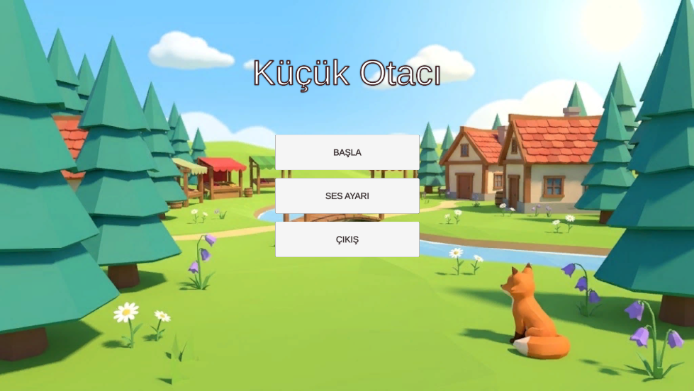 | 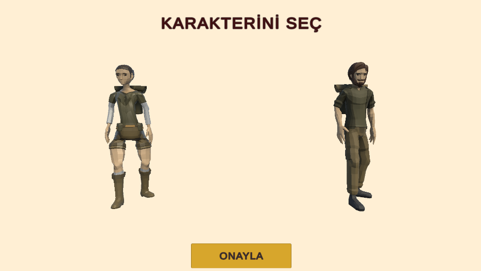 |
| 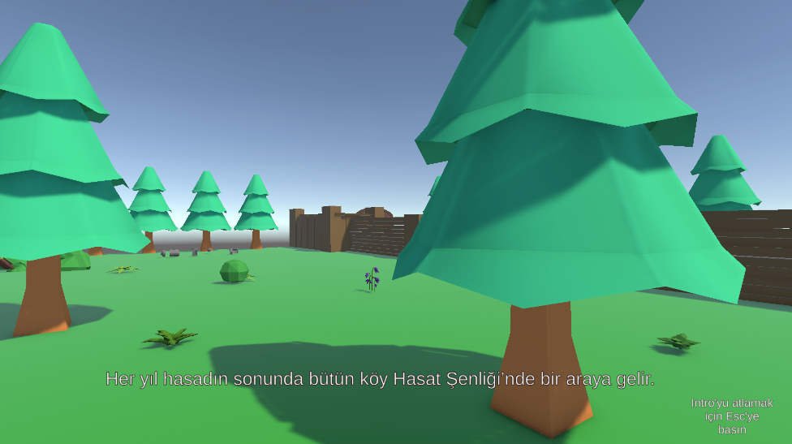 | 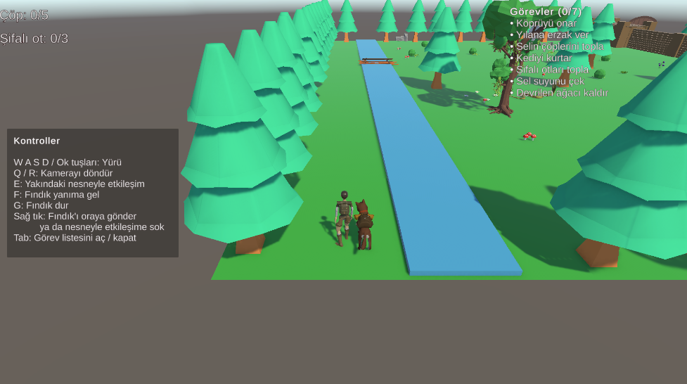 |
| 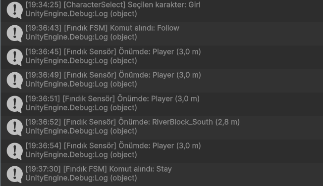 | 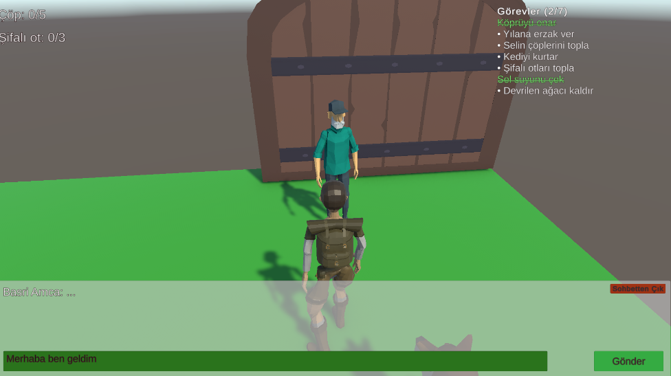 |
| 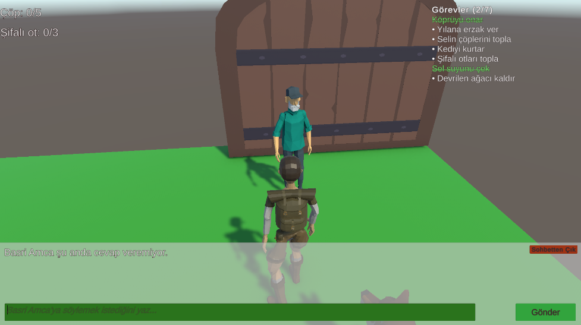 | 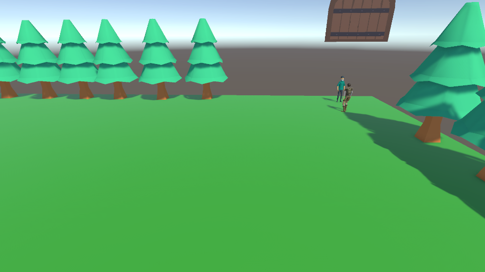 |
| 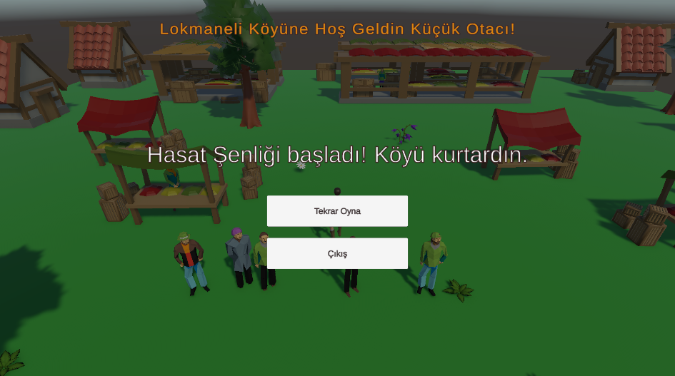 | 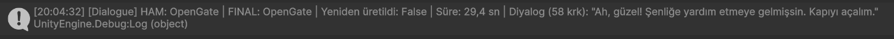 |

## İş Bölümü

| Alan | Hatice | Meryem |
|------|--------|--------|
| Yerel LLM entegrasyonu (OllamaClient, ayrıştırma), diyalog mantığı, doğrulama, prompt ve testleri | ✔ | |
| Ana menü, karakter seçimi, giriş ara sahnesi, bitiş (kapı sekansı, Festival, final paneli) | ✔ | |
| Kamera, görev listesi ve bildirimleri, oyuncu modeli ve animasyonu | | ✔ |
| Fındık: NavMesh, FSM, Raycast sensörü, komut girişi | ✔ | |
| Görev sistemi, görev nesneleri (köprü, ağaç, kedi, vana, yılan, çöp, şifalı ot) | | ✔ |
| Sahne ve çevre tasarımı, Basri Amca modeli, diyalog arayüz iskeleti | | ✔ |

## Kaynaklar ve Lisanslar

Kullanılan 3D modeller, ses efektleri ve diğer harici varlıkların kaynakları ve lisansları [CREDITS.md](CREDITS.md) dosyasındadır.

## Kullanılan Teknolojiler

- Unity
- C#
- NavMesh
- Raycast
- Ollama (gemma2:2b)
- Yerel LLM
- Git ve GitHub
- Markdown ve Mermaid